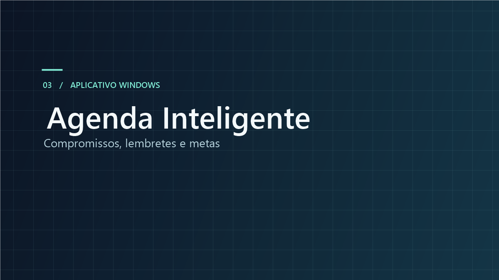
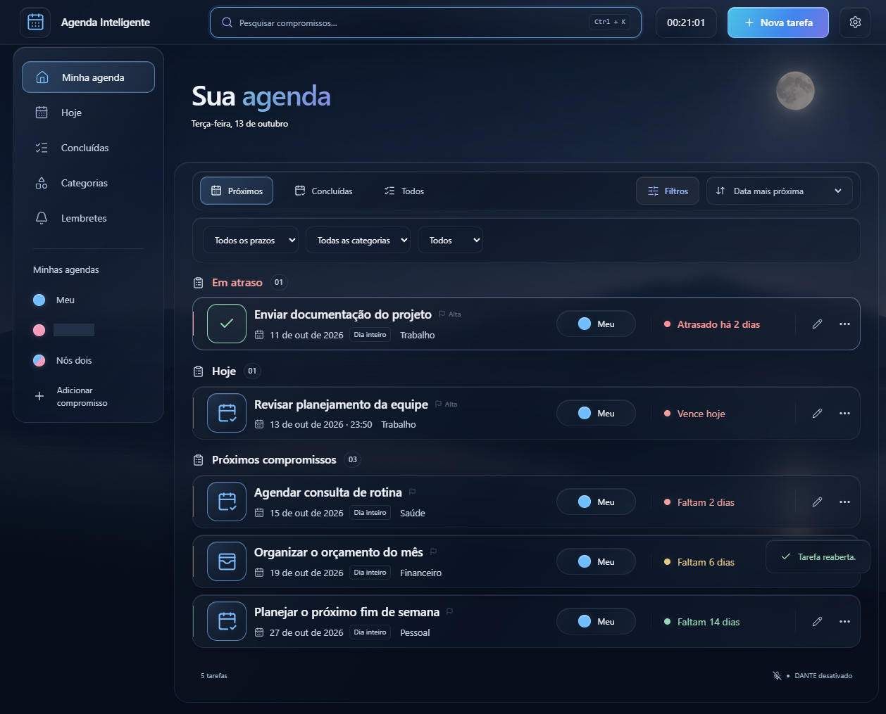

# Agenda Inteligente

**Aplicativo desktop Windows para compromissos, lembretes e metas, com armazenamento local.**

[Portfólio de Pedro Henrique Bertone](https://github.com/Sydenci#projetos) · [Demonstração documentada](docs/demonstracao.md) · [Contato profissional](https://www.linkedin.com/in/pedro-bertone-0890822b5/)

## O problema

Compromissos pontuais e metas recorrentes exigem formas diferentes de acompanhamento. A Agenda Inteligente reúne os dois fluxos em uma aplicação local para organizar a rotina, consultar o histórico e acompanhar cada ocorrência.

## Funcionalidades implementadas

- Criação, edição e conclusão de tarefas e compromissos, com pesquisa, filtros, prioridades e histórico.
- Agendamento com data e horário, dia inteiro, intervalos de datas e lembretes por mês.
- Alarme sonoro local uma hora antes de compromissos pendentes com data e hora definidas, com confirmação registrada.
- Metas com dias recorrentes, conclusão por ocorrência, calendário e relatórios mensais.
- Exportação e importação de backups dos dados do aplicativo.

Os avisos funcionam com o aplicativo em execução, inclusive na bandeja. O armazenamento dos dados é local.

## Minha participação

Concebo e desenvolvo a aplicação com apoio de inteligência artificial, organizando funcionalidades, testando os fluxos de agenda e metas e aprimorando a experiência no Windows.

## Demonstração

*Capturas com dados de teste. O painel e o formulário documentam versões anteriores. O aviso de alarme e as telas de metas pertencem à versão 2.6.0.*

[Ver as cinco capturas e seus contextos](docs/demonstracao.md)

## Tecnologias do projeto

Electron · React · TypeScript · SQLite

## Sobre este repositório

Repositório público de apresentação do projeto, com documentação e imagens demonstrativas. O aplicativo e seu código-fonte têm distribuição privada.

**Autoria — Pedro Henrique Bertone**

[LinkedIn](https://www.linkedin.com/in/pedro-bertone-0890822b5/) · [E-mail](mailto:pedrohbertone@outlook.com)
