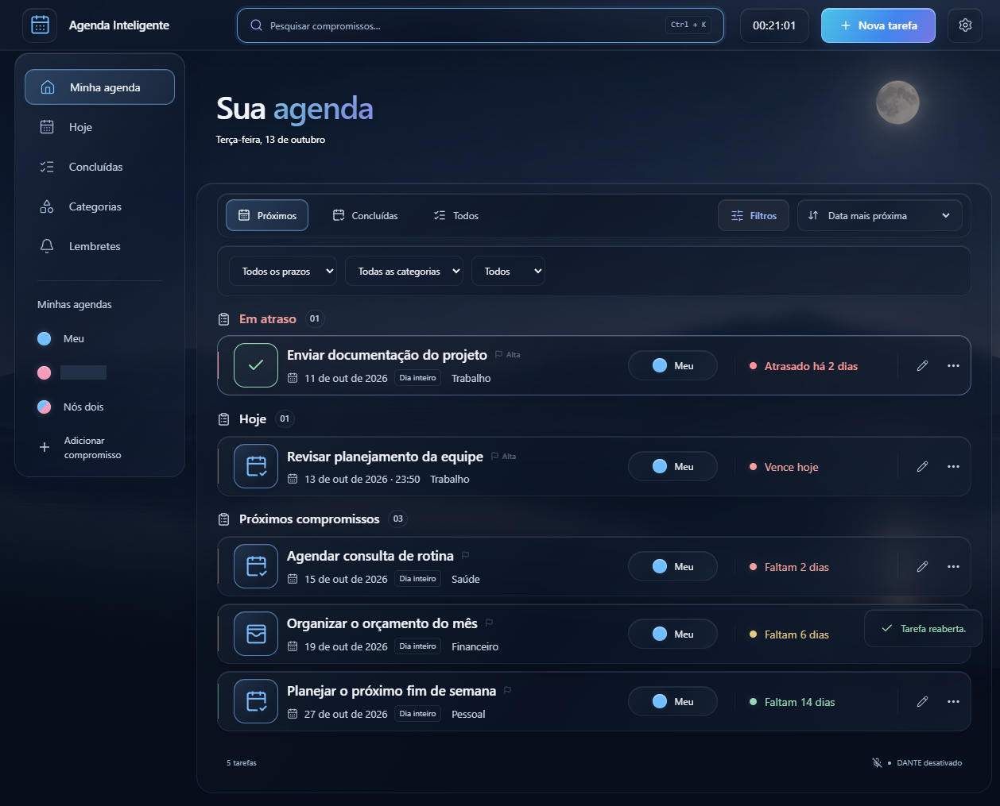
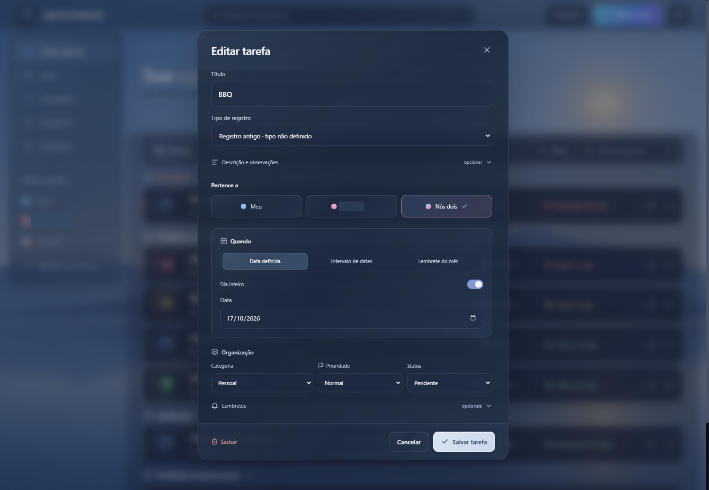
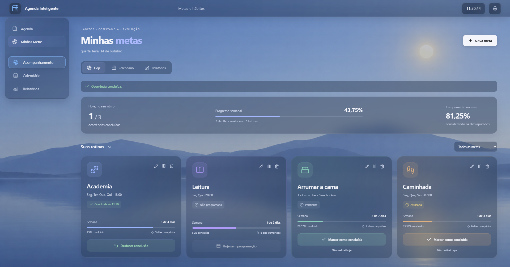
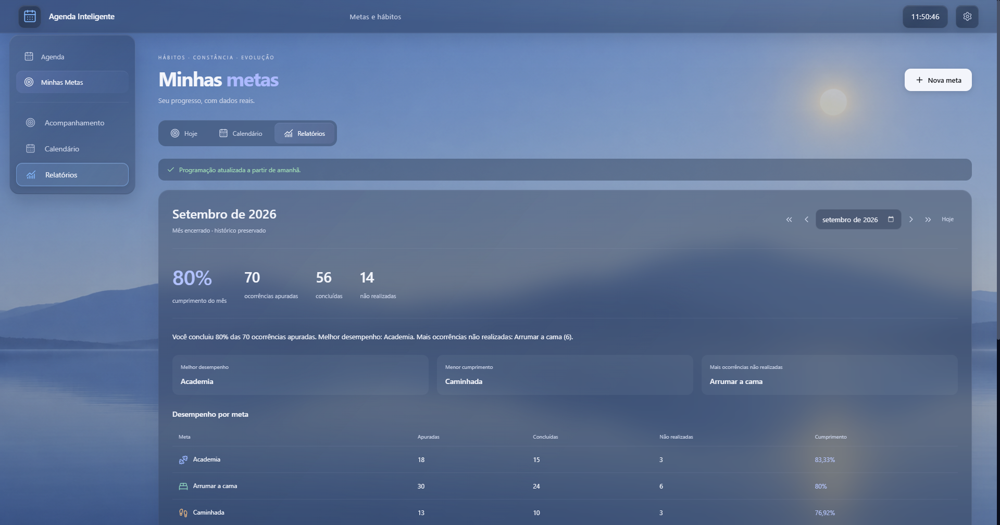

# Demonstração da Agenda Inteligente

[Voltar à apresentação](../README.md)

As capturas registram testes desktop com dados de exemplo. Nomes foram cobertos por máscaras opacas nas cópias aprovadas do painel, do formulário e do aviso de alarme.

## Painel de compromissos

Pesquisa, filtros e agrupamento por prazo em uma lista preenchida com tarefas de exemplo. Esta imagem documenta uma versão anterior da interface.

## Edição de compromisso

O formulário reúne data, categoria, prioridade, estado e lembretes. Esta imagem pertence a uma versão anterior e apresenta um registro legado.

## Aviso de alarme

Registro do aviso de uma hora antes do compromisso e da ação de confirmação. A imagem pertence à versão 2.6.0. O título do compromisso está mascarado na cópia aprovada.

## Acompanhamento de metas

Rotinas com frequências diferentes e estados por ocorrência, acompanhadas de indicadores calculados sobre os dados de teste. Imagem da versão 2.6.0.

## Relatório mensal de metas

Consolidação de ocorrências concluídas e não realizadas por meta em um mês encerrado. Os números exibidos pertencem ao cenário de teste e ilustram o funcionamento do relatório. Imagem da versão 2.6.0.

## Funcionamento local

O aplicativo usa armazenamento local e permite exportar e importar backups. Os lembretes dependem de o aplicativo permanecer em execução, inclusive na bandeja. O conjunto de imagens registra mais de uma versão da interface e está identificado por contexto nesta documentação.
